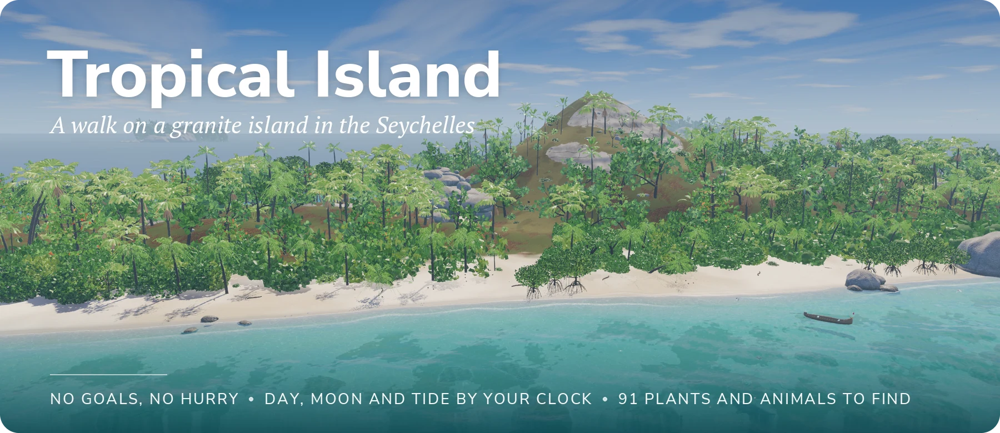
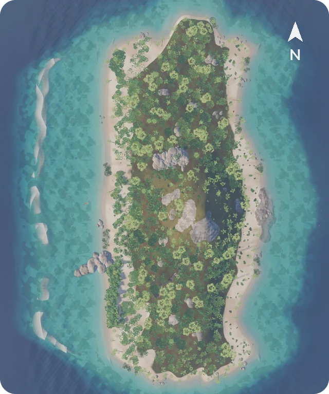
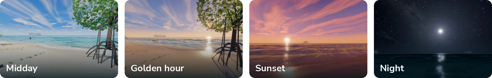
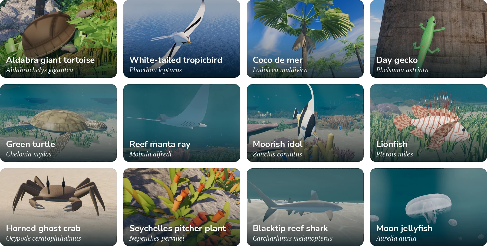
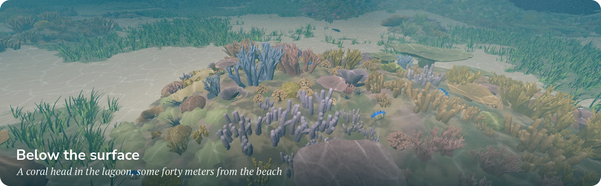

  

  <em>You arrive on a beach. There is nothing to win and nobody tells you where to go. 
  Walk, wade out, put your face in the water, climb the hill, wait for the evening.</em>

  
  &nbsp;&nbsp;
  

## The island

A granite island of the Seychelles, some 420 meters from end to end, as it would be if
nobody had ever landed there: no paths, no houses, no signs. White beaches, a forest of
takamaka and palms, a summit of bare granite 44 meters up, a stream and a pond, a grotto
under leaning boulders, mangroves, and all around it a lagoon inside a reef on which the
swell breaks.

The island itself is imagined: no chart of the Seychelles shows it. Its plants and animals
are real, gathered from across the islands.

You walk it in the first person, at your own pace. Where the water gets deep you swim;
look down and you snorkel; press <kbd>Space</kbd> and you dive on one breath, level with
the garden eels and the grouper.

The animals keep a calm distance and go on with their lives. Nothing here hurts you, and
nothing hurries you.

**[The island in words](docs/island.md)** tells all of it, place by place.

 

## It keeps your time

  

Start it at six in the evening and you arrive for the sunset. The sun, the moon and the stars
stand where they stand over the Seychelles, 4.6 degrees south of the equator, on today's
date. The moon has today's phase, and the tide follows it at its real pace, so the shore
you find depends on the hour you come. Rarely a shower passes, and may leave a rainbow. On
some nights the sea glows blue in the surf and in your footprints.

Each of these has a key for the days you would rather choose: <kbd>T</kbd> the time of
day, <kbd>M</kbd> the moon, <kbd>G</kbd> the tide, <kbd>N</kbd> rain, <kbd>B</kbd> the
glowing sea.

## Ninety-one plants and animals

  

Every one of them lives in the Seychelles, and stands, crawls, flies or swims where it
does there: giant tortoises grazing on the ridge, tropicbirds about the granite, a seabird
colony loud on the southern headland, pitcher plants on the slabs below the summit, a
hawksbill that comes up the beach to nest by day.

The **[manual](manual/Tropical%20Island%20-%20Manual.pdf)** is a field guide to all of
them: 28 pages, a picture of each taken in the game, where to look, and a box to tick.

  

## Keys

| Key | What it does |
| :-- | :-- |
| <kbd>W</kbd> <kbd>A</kbd> <kbd>S</kbd> <kbd>D</kbd> | walk; <kbd>Shift</kbd> to jog, <kbd>C</kbd> to crouch, the mouse to look around |
| <kbd>Space</kbd> | hop; in deep water, dive where you look |
| <kbd>T</kbd> <kbd>M</kbd> <kbd>G</kbd> | time of day, moon and tide: by your clock, or as you like them |
| <kbd>N</kbd> <kbd>B</kbd> | call a rain shower; call the sea's glow at night |
| <kbd>P</kbd> | take a photo, saved to your Pictures folder |
| <kbd>F</kbd> <kbd>R</kbd> <kbd>H</kbd> | free camera; back to firm ground if you are stuck; all the shortcuts |

## Get it

**[Download the disk image](../../releases/latest)** (for a Mac with Apple silicon and
macOS 11 or later; about 320 MB), open it and drag the island onto
Applications. The manual lies beside it, and inside the app under *Help › Manual*.

The app is not notarized by Apple, so macOS refuses the first start. Allow it once in
*System Settings › Privacy & Security* with **Open Anyway**; after that it opens like any
other app. There is no build for Intel Macs: the graphics of most of them are too slow for the
island.

To run it from the source instead, open this folder in [Godot 4.7.2](https://godotengine.org)
and press <kbd>⌘</kbd> <kbd>B</kbd>. **[Working on Tropical Island](docs/development.md)**
has the rest: building the app, the manual and the disk image, and where things are.

## How it was made

Idea and direction by Hanno Teeling. Concept extension and initial implementation by
Claude Opus 5.5. Further substantial extension and refinement by Claude Fable 5.2.

It began as a Blender animation of a single beach and grew, a wish at a time, into an
island. The engine is [Godot](https://godotengine.org) 4.7.2. The terrain, the trees and
the first animals were grown by Python scripts in Blender; everything since is built in code
as the game starts. Textures and the icon were made with Z Image Turbo, the sounds with
Stable Audio 3. Every picture on this page was taken in the game.

## License

Tropical Island © 2026 Hanno Teeling is licensed under
[CC BY-NC-SA 4.0](https://creativecommons.org/licenses/by-nc-sa/4.0/) (see [`LICENSE`](LICENSE)):
you are welcome to copy, fork and change it, as long as you give credit, do not use it
commercially, and pass on what you make of it under the same license. Godot Engine and its
parts, which a built app contains, keep their own licenses
([`THIRD-PARTY-LICENSES.txt`](THIRD-PARTY-LICENSES.txt)), and so does the Godot AI addon in
`addons/godot_ai` (MIT).

